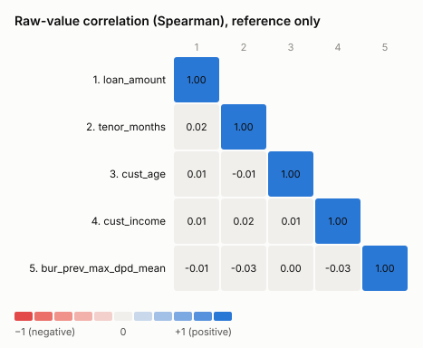

# Data dictionary and outliers

Every build documents the raw modelling data, one row per column, in three places:
the **Raw data** section of `waterfall_report.md`, and on their own as
`data_dictionary.md` and `data_dictionary.csv`.

Code: `autoscorecard/engine/dictionary.py`. Example:
[`examples/data_dictionary.md`](examples/data_dictionary.md).

## What is documented

| field | where it comes from |
|---|---|
| variable | column name in the modelling dataset |
| description | **supplied by you** (dictionary file or API). A derived column inherits its source's description, e.g. `Mean of: worst days past due on a previous loan`. Never invented: if missing, it reads `(not provided)` |
| variable type | **supplied by you** (loan, funding, bureau / credit history, demographic, income & employment, application, …, any label you like). If missing it is inherited from the source column, or guessed from the name and marked `(guessed)` |
| role | `in final model`, `candidate feature`, `target` or `not used` |
| data type | measured: integer, decimal, integer (stored as decimal: whole numbers held as decimals, usually because of missing values), text, date, boolean |
| variable logic | **recorded automatically** for derived columns: joins (`customers.age; left join customers on cust_id = cust_id; missing when …`), aggregations (`mean of bureau.prev_max_dpd per cust_id; …`) and the target (`1 if perf_max_dpd_12m >= 90 …`). Logic you supply for a source column is kept in front (`income cut at 4, 7 and 12 million IDR; then …`). Raw columns read `raw: table.column` |
| data count | rows in the modelling dataset (all samples) |
| null count, null % | measured |
| distinct | measured |
| min, max | measured, for numeric and date columns, on the raw values (before any outlier treatment) |
| outlier method, lower/upper fence, outlier count | see below |
| outlier treatment | `none` or `capped` |

Statistics cover the whole modelling dataset (train + test + out-of-time). The
outlier fences are fitted on the training sample only.

## Supplying descriptions and variable types

Upload your data dictionary as CSV or Excel. Common header spellings work,
including Indonesian ones:

| meaning | accepted headers |
|---|---|
| variable | `variable`, `column`, `name`, `field`, `variabel`, `kolom` |
| description | `description`, `desc`, `definition`, `deskripsi`, `keterangan` |
| variable type | `category`, `variable_type`, `type`, `group`, `kategori`, `jenis` |
| logic | `logic`, `formula`, `derivation`, `rumus`, `logika` |

Describe the **source** columns (`age`, `prev_max_dpd`, …). The joined and
aggregated columns (`cust_age`, `bur_prev_max_dpd_mean`, …) pick the description
up automatically. You can also describe a modelling column directly, which
takes precedence.

| API | purpose |
|---|---|
| `POST /api/projects/{id}/upload` then `POST /api/projects/{id}/dictionary/import {"file": "dict.xlsx"}` | import a dictionary file |
| `PUT /api/projects/{id}/dictionary {"rows": [{"variable": ..., "description": ..., "category": ...}]}` | add or change entries (merged) |
| `GET /api/projects/{id}/dictionary` | current entries, including recorded lineage |

The documentation lists what is still missing ("To complete: …").

## Outliers

**Detection** (numeric columns with more than 10 distinct values; fewer than
that are categories or counts, where "outlier" makes no sense):

- `iqr` (default): Tukey fences. A value is an outlier if it is below
  Q1 − k×IQR or above Q3 + k×IQR, with Q1/Q3 the 25th/75th percentiles of the
  training sample and k = 1.5.
- `percentile`: below the `lower` (1%) or above the `upper` (99%) percentile of
  the training sample.

On skewed variables such as DPD or amounts, IQR flags many values (5–8% in the
demo). That is expected, and is one reason the default is not to cap.

**Treatment:**

- `none` (default). Values are kept. This is safe for a WoE scorecard: the first
  and last bins are open-ended, so an extreme value only gets the WoE of its end
  bin. **How extreme it is makes no difference**: the test suite multiplies the
  outliers by 1,000 and gets identical bins, WoE and points. New data at scoring
  time is just as safe.
- `cap`. Values beyond a fence are replaced by the fence value before binning, in
  every sample. Raw statistics and the raw correlation change. When many values
  lie beyond a fence they all become one value, so the end bins can merge and
  their WoE and points can change. New data must then be capped the same way
  before scoring.

Configure in `config/config.yaml`:

```yaml
modelling:
  outliers: {method: iqr, k: 1.5, treatment: none}   # or percentile / lower / upper, cap
```

The rule, the fences and the counts per variable are written to the audit log.

## Raw-value correlation (reference)

Next to the WoE correlation of the final model, the report shows a Spearman rank
correlation of the **raw** values of the final model's numeric features. It is
computed on the training sample (after outlier treatment, if any), with missing
values left out pair by pair.

It is for reference only: the model uses WoE, so the clustering limit applies to
the WoE matrix. Categorical features have no raw numeric value, so they are
listed as not shown.


