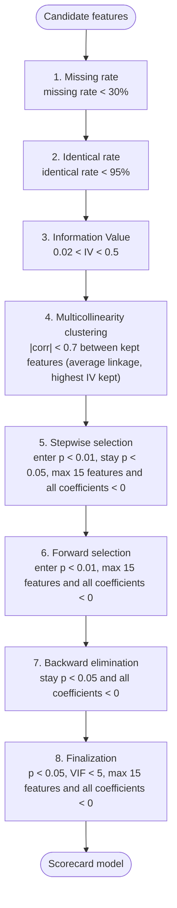

## Modelling waterfall plan

Status: **waiting for approval**

| # | step | keeps a feature when | what it means |
|---|---|---|---|
| 1 | Missing rate | missing rate < 30% | Share of rows where the feature is empty. Measured on the training sample. |
| 2 | Identical rate | identical rate < 95% | Share of rows holding the single most frequent value (missing counts as a value unless include_missing is false). Catches near-constant features. |
| 3 | Information Value | 0.02 < IV < 0.5 | IV of the monotonic WoE binning. Below min = no predictive power; above max = suspiciously strong, often leakage from the outcome. |
| 4 | Multicollinearity clustering | \|corr\| < 0.7 between kept features (average linkage, highest IV kept) | Hierarchical clustering of the WoE correlation matrix, distance 1-\|corr\|. Features linked at \|corr\| >= threshold form a cluster; only the highest-IV member stays. |
| 5 | Stepwise selection | enter p < 0.01, stay p < 0.05, max 15 features and all coefficients < 0 | Add the feature with the smallest likelihood-ratio p-value (< p_enter), then remove any whose Wald p-value rose above p_remove. Repeat. |
| 6 | Forward selection | enter p < 0.01, max 15 features and all coefficients < 0 | Start empty and add features one by one while the best LR p-value < p_enter. |
| 7 | Backward elimination | stay p < 0.05 and all coefficients < 0 | Start with all features and remove the one with the largest Wald p-value while it is above p_remove. |
| 8 | Finalization | p < 0.05, VIF < 5, max 15 features and all coefficients < 0 | Final checks on the model, fixed one feature at a time: positive coefficient, then p-value, then VIF, then the feature count (weakest \|z\| out first). Forced features are added back here and discarded only if they still fail. |
