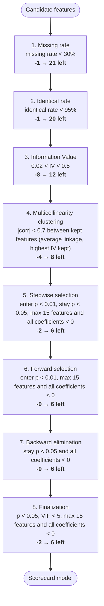

# Modelling waterfall report

Generated 2026-10-18 01:23. 22 candidate features → **6 in the final model**.

## Summary

| order | step | criterion | n_in | n_added | n_dropped | n_out |
|---|---|---|---|---|---|---|
| 0 | Input | candidate features | 22 | 0 | 0 | 22 |
| 1 | Missing rate | missing rate < 30% | 22 | 0 | 1 | 21 |
| 2 | Identical rate | identical rate < 95% | 21 | 0 | 1 | 20 |
| 3 | Information Value | 0.02 < IV < 0.5 | 20 | 0 | 8 | 12 |
| 4 | Multicollinearity clustering | \|corr\| < 0.7 between kept features (average linkage, highest IV kept) | 12 | 0 | 4 | 8 |
| 5 | Stepwise selection | enter p < 0.01, stay p < 0.05, max 15 features and all coefficients < 0 | 8 | 0 | 2 | 6 |
| 6 | Forward selection | enter p < 0.01, max 15 features and all coefficients < 0 | 6 | 0 | 0 | 6 |
| 7 | Backward elimination | stay p < 0.05 and all coefficients < 0 | 6 | 0 | 0 | 6 |
| 8 | Finalization | p < 0.05, VIF < 5, max 15 features and all coefficients < 0 | 6 | 2 | 2 | 6 |

## Flow

## Raw data

Rows: oot 764, test 1,571, train 3,665 · columns: 27.

**Outlier detection:** IQR (Tukey) fences: a value is an outlier if it is below Q1 − 1.5×IQR or above Q3 + 1.5×IQR, with Q1/Q3 the 25th/75th percentiles of the training sample. Numeric columns with 10 or fewer distinct values are not tested.

**Outlier treatment:** none: values are kept as they are. Binning makes this safe: the first and last bins are open-ended, so an extreme value only receives the WoE of its end bin and cannot pull the model; the same holds for new data at scoring time.

**To complete:** 3 variable(s) without a description, 1 with a guessed variable type. Upload a data dictionary (columns: variable, description, category, logic) to fill them.

### Variables

| variable | description | variable_type | role | data_type | logic |
|---|---|---|---|---|---|
| app_id | Application number | identifier | not used | text | raw: applications.app_id |
| cust_id | Customer number (CIF) | identifier | not used | text | raw: applications.cust_id |
| app_date | Date the application was submitted | application | not used | date | raw: applications.app_date |
| loan_amount | Requested loan amount (IDR) | loan | in final model | integer (stored as decimal) | raw: applications.loan_amount |
| tenor_months | Requested tenor in months | loan | in final model | integer | raw: applications.tenor_months |
| channel | Channel the application came through | application | in final model | text | raw: applications.channel |
| is_staff_loan | 1 if the applicant is a bank employee | loan | candidate feature | integer | raw: applications.is_staff_loan |
| noise_a | (not provided) | (not provided) | candidate feature | decimal | raw: applications.noise_a |
| noise_b | (not provided) | (not provided) | candidate feature | text | raw: applications.noise_b |
| cust_age | Age at application (years) | demographic | in final model | integer | customers.age; left join customers on cust_id = cust_id; missing when the key has no customers record |
| cust_income | Declared monthly income (IDR) | income & employment | in final model | integer (stored as decimal) | customers.income; left join customers on cust_id = cust_id; missing when the key has no customers record |
| cust_income_band | Declared monthly income band | income & employment | candidate feature | text | income cut at 4, 7 and 12 million IDR; then customers.income_band; left join customers on cust_id = cust_id; missing when the key has no customers record |
| cust_marital_status | Marital status | demographic | candidate feature | text | customers.marital_status; left join customers on cust_id = cust_id; missing when the key has no customers record |
| cust_province | Province of residence | demographic | candidate feature | text | customers.province; left join customers on cust_id = cust_id; missing when the key has no customers record |
| cust_years_at_job | Years with current employer | income & employment | candidate feature | decimal | customers.years_at_job; left join customers on cust_id = cust_id; missing when the key has no customers record |
| cust_spouse_income | Declared monthly income of spouse (IDR) | income & employment | candidate feature | integer (stored as decimal) | customers.spouse_income; left join customers on cust_id = cust_id; missing when the key has no customers record |
| bur_count | (not provided) | bureau / credit history (guessed) | candidate feature | integer (stored as decimal) | number of bureau rows per cust_id; left join bureau on cust_id = cust_id; missing when the key has no bureau record |
| bur_prev_amount_mean | Mean of: amount of a previous loan at any bank (IDR) | bureau / credit history | candidate feature | decimal | mean of bureau.prev_amount per cust_id; left join bureau on cust_id = cust_id; missing when the key has no bureau record |
| bur_prev_amount_max | Maximum of: amount of a previous loan at any bank (IDR) | bureau / credit history | candidate feature | integer (stored as decimal) | maximum of bureau.prev_amount per cust_id; left join bureau on cust_id = cust_id; missing when the key has no bureau record |
| bur_prev_amount_min | Minimum of: amount of a previous loan at any bank (IDR) | bureau / credit history | candidate feature | integer (stored as decimal) | minimum of bureau.prev_amount per cust_id; left join bureau on cust_id = cust_id; missing when the key has no bureau record |
| bur_prev_amount_sum | Sum of: amount of a previous loan at any bank (IDR) | bureau / credit history | candidate feature | integer (stored as decimal) | sum of bureau.prev_amount per cust_id; left join bureau on cust_id = cust_id; missing when the key has no bureau record |
| bur_prev_max_dpd_mean | Mean of: worst days past due on a previous loan | bureau / credit history | in final model | decimal | mean of bureau.prev_max_dpd per cust_id; left join bureau on cust_id = cust_id; missing when the key has no bureau record |
| bur_prev_max_dpd_max | Maximum of: worst days past due on a previous loan | bureau / credit history | candidate feature | integer (stored as decimal) | maximum of bureau.prev_max_dpd per cust_id; left join bureau on cust_id = cust_id; missing when the key has no bureau record |
| bur_prev_max_dpd_min | Minimum of: worst days past due on a previous loan | bureau / credit history | candidate feature | integer (stored as decimal) | minimum of bureau.prev_max_dpd per cust_id; left join bureau on cust_id = cust_id; missing when the key has no bureau record |
| bur_prev_max_dpd_sum | Sum of: worst days past due on a previous loan | bureau / credit history | candidate feature | integer (stored as decimal) | sum of bureau.prev_max_dpd per cust_id; left join bureau on cust_id = cust_id; missing when the key has no bureau record |
| perf_max_dpd_12m | Worst days past due in the 12 months after booking | target / performance | not used | integer | performance.max_dpd_12m; left join performance on app_id = app_id; missing when the key has no performance record |
| bad | Bad flag: the outcome the scorecard predicts | target / performance | target | integer (stored as decimal) | 1 if perf_max_dpd_12m >= 90 (90+ days past due within 12 months), else 0 |

### Statistics

| variable | count | null_count | null_pct | distinct | min | max | outlier_method | outlier_lower | outlier_upper | outlier_count | outlier_treatment |
|---|---|---|---|---|---|---|---|---|---|---|---|
| app_id | 6000 | 0 | 0.0% | 6000 |  |  | not applicable (non-numeric) |  |  |  | none |
| cust_id | 6000 | 0 | 0.0% | 3616 |  |  | not applicable (non-numeric) |  |  |  | none |
| app_date | 6000 | 0 | 0.0% | 730 | 2023-01-01 | 2024-12-30 | not applicable (non-numeric) |  |  |  | none |
| loan_amount | 6000 | 0 | 0.0% | 525 | 1,600,000 | 120,700,000 | iqr | -7,200,000 | 38,400,000 | 282 | none |
| tenor_months | 6000 | 0 | 0.0% | 5 | 6 | 36 | not tested (≤ 10 distinct values) |  |  |  | none |
| channel | 6000 | 0 | 0.0% | 3 |  |  | not applicable (non-numeric) |  |  |  | none |
| is_staff_loan | 6000 | 0 | 0.0% | 2 | 0 | 1 | not tested (≤ 10 distinct values) |  |  |  | none |
| noise_a | 6000 | 0 | 0.0% | 6000 | -3.294 | 3.713 | iqr | -2.694 | 2.737 | 47 | none |
| noise_b | 6000 | 0 | 0.0% | 4 |  |  | not applicable (non-numeric) |  |  |  | none |
| cust_age | 6000 | 0 | 0.0% | 44 | 21 | 64 | iqr | -3.5 | 88.5 | 0 | none |
| cust_income | 6000 | 0 | 0.0% | 1145 | 1,020,000 | 45,390,000 | iqr | -1,840,000 | 14,400,000 | 181 | none |
| cust_income_band | 6000 | 0 | 0.0% | 4 |  |  | not applicable (non-numeric) |  |  |  | none |
| cust_marital_status | 6000 | 0 | 0.0% | 3 |  |  | not applicable (non-numeric) |  |  |  | none |
| cust_province | 6000 | 0 | 0.0% | 7 |  |  | not applicable (non-numeric) |  |  |  | none |
| cust_years_at_job | 6000 | 420 | 7.0% | 235 | 0 | 48.4 | iqr | -7.15 | 15.65 | 225 | none |
| cust_spouse_income | 6000 | 3026 | 50.4% | 833 | 690,000 | 26,280,000 | iqr | -2,812,500 | 12,327,500 | 128 | none |
| bur_count | 6000 | 789 | 13.2% | 8 | 1 | 8 | not tested (≤ 10 distinct values) |  |  |  | none |
| bur_prev_amount_mean | 6000 | 789 | 13.2% | 2077 | 380,000 | 41,870,000 | iqr | -2,160,312 | 14,672,188 | 250 | none |
| bur_prev_amount_max | 6000 | 789 | 13.2% | 1540 | 380,000 | 73,270,000 | iqr | -5,435,000 | 22,685,000 | 251 | none |
| bur_prev_amount_min | 6000 | 789 | 13.2% | 1018 | 340,000 | 41,870,000 | iqr | -2,623,750 | 10,506,250 | 355 | none |
| bur_prev_amount_sum | 6000 | 789 | 13.2% | 2017 | 380,000 | 91,820,000 | iqr | -15,066,250 | 43,243,750 | 199 | none |
| bur_prev_max_dpd_mean | 6000 | 789 | 13.2% | 273 | 0 | 185 | iqr | -8.25 | 17.75 | 420 | none |
| bur_prev_max_dpd_max | 6000 | 789 | 13.2% | 104 | 0 | 234 | iqr | -13 | 27 | 413 | none |
| bur_prev_max_dpd_min | 6000 | 789 | 13.2% | 61 | 0 | 185 | iqr | -6 | 10 | 475 | none |
| bur_prev_max_dpd_sum | 6000 | 789 | 13.2% | 136 | 0 | 484 | iqr | -18 | 38 | 497 | none |
| perf_max_dpd_12m | 6000 | 0 | 0.0% | 151 | 0 | 180 | not tested (not a candidate feature) |  |  |  | none |
| bad | 6000 | 0 | 0.0% | 2 | 0 | 1 | not tested (not a candidate feature) |  |  |  | none |

## 1. Missing rate

Keeps a feature when: **missing rate < 30%**. Share of rows where the feature is empty. Measured on the training sample.

In: 22 · dropped: 1 · out: 21

Dropped:

| feature | reason |
|---|---|
| cust_spouse_income | missing rate 51.3% >= 30% |

## 2. Identical rate

Keeps a feature when: **identical rate < 95%**. Share of rows holding the single most frequent value (missing counts as a value unless include_missing is false). Catches near-constant features.

In: 21 · dropped: 1 · out: 20

Dropped:

| feature | reason |
|---|---|
| is_staff_loan | identical rate 97.8% >= 95% (value 0) |

## 3. Information Value

Keeps a feature when: **0.02 < IV < 0.5**. IV of the monotonic WoE binning. Below min = no predictive power; above max = suspiciously strong, often leakage from the outcome.

In: 20 · dropped: 8 · out: 12

Dropped:

| feature | reason |
|---|---|
| noise_a | IV 0.0107 <= 0.02 |
| noise_b | IV 0.0008 <= 0.02 |
| cust_marital_status | IV 0.0005 <= 0.02 |
| cust_years_at_job | IV 0.0104 <= 0.02 |
| bur_count | IV 0.0028 <= 0.02 |
| bur_prev_amount_mean | IV 0.0107 <= 0.02 |
| bur_prev_amount_min | IV 0.0108 <= 0.02 |
| bur_prev_amount_sum | IV 0.0136 <= 0.02 |

## 4. Multicollinearity clustering

Keeps a feature when: **|corr| < 0.7 between kept features (average linkage, highest IV kept)**. Hierarchical clustering of the WoE correlation matrix, distance 1-|corr|. Features linked at |corr| >= threshold form a cluster; only the highest-IV member stays.

In: 12 · dropped: 4 · out: 8

Clusters with more than one member (first = kept, highest IV):

- bur_prev_max_dpd_mean, bur_prev_max_dpd_max, bur_prev_max_dpd_sum
- cust_income, cust_income_band

Dropped:

| feature | reason |
|---|---|
| cust_income_band | correlated with cust_income (\|corr\|=0.90, IV 0.183 < 0.251) |
| bur_prev_max_dpd_max | correlated with bur_prev_max_dpd_mean (\|corr\|=0.91, IV 0.249 < 0.294) |
| bur_prev_max_dpd_sum | correlated with bur_prev_max_dpd_mean (\|corr\|=0.83, IV 0.249 < 0.294) |
| bur_prev_max_dpd_min | \|corr\| with bur_prev_max_dpd_mean = 0.74 >= 0.7 (pairwise check after clustering; IV 0.223 < 0.294) |

## 5. Stepwise selection

Keeps a feature when: **enter p < 0.01, stay p < 0.05, max 15 features and all coefficients < 0**. Add the feature with the smallest likelihood-ratio p-value (< p_enter), then remove any whose Wald p-value rose above p_remove. Repeat.

In: 8 · dropped: 2 · out: 6

Selection trace:

| step | action | feature | p_value | aic | reason |
|---|---|---|---|---|---|
| 1 | add | bur_prev_max_dpd_mean | 1.479e-23 | 2358 | LR chi2=100.06, p=1.479e-23 < 0.01 |
| 2 | add | cust_income | 1.296e-19 | 2278 | LR chi2=82.10, p=1.296e-19 < 0.01 |
| 3 | add | cust_age | 9.593e-16 | 2216 | LR chi2=64.51, p=9.593e-16 < 0.01 |
| 4 | add | channel | 6.184e-07 | 2193 | LR chi2=24.85, p=6.184e-07 < 0.01 |
| 5 | add | loan_amount | 1.296e-05 | 2176 | LR chi2=19.02, p=1.296e-05 < 0.01 |
| 6 | add | tenor_months | 0.00101 | 2167 | LR chi2=10.81, p=0.00101 < 0.01 |

Dropped:

| feature | reason |
|---|---|
| cust_province | not entered: LR p=0.06143 >= 0.01 given the selected features |
| bur_prev_amount_max | not entered: LR p=0.06819 >= 0.01 given the selected features |

## 6. Forward selection

Keeps a feature when: **enter p < 0.01, max 15 features and all coefficients < 0**. Start empty and add features one by one while the best LR p-value < p_enter.

In: 6 · dropped: 0 · out: 6

Selection trace:

| step | action | feature | p_value | aic | reason |
|---|---|---|---|---|---|
| 1 | add | bur_prev_max_dpd_mean | 1.479e-23 | 2358 | LR chi2=100.06, p=1.479e-23 < 0.01 |
| 2 | add | cust_income | 1.296e-19 | 2278 | LR chi2=82.10, p=1.296e-19 < 0.01 |
| 3 | add | cust_age | 9.593e-16 | 2216 | LR chi2=64.51, p=9.593e-16 < 0.01 |
| 4 | add | channel | 6.184e-07 | 2193 | LR chi2=24.85, p=6.184e-07 < 0.01 |
| 5 | add | loan_amount | 1.296e-05 | 2176 | LR chi2=19.02, p=1.296e-05 < 0.01 |
| 6 | add | tenor_months | 0.00101 | 2167 | LR chi2=10.81, p=0.00101 < 0.01 |

## 7. Backward elimination

Keeps a feature when: **stay p < 0.05 and all coefficients < 0**. Start with all features and remove the one with the largest Wald p-value while it is above p_remove.

In: 6 · dropped: 0 · out: 6

## 8. Finalization

Keeps a feature when: **p < 0.05, VIF < 5, max 15 features and all coefficients < 0**. Final checks on the model, fixed one feature at a time: positive coefficient, then p-value, then VIF, then the feature count (weakest |z| out first). Forced features are added back here and discarded only if they still fail.

In: 6 · dropped: 2 · out: 6

Dropped:

| feature | reason |
|---|---|
| cust_years_at_job | forced into the model but still fails: p-value 0.1024 >= 0.05 |
| cust_province | forced into the model but still fails: p-value 0.0674 >= 0.05 |

## Final model

| term | coef | std_err | z | p_value |
|---|---|---|---|---|
| intercept | -2.152 | 0.06026 | -35.71 | 2.991e-279 |
| loan_amount | -1.161 | 0.2759 | -4.207 | 2.588e-05 |
| tenor_months | -1.153 | 0.3463 | -3.331 | 0.000866 |
| channel | -1.121 | 0.2187 | -5.127 | 2.951e-07 |
| cust_age | -1.058 | 0.1379 | -7.674 | 1.667e-14 |
| cust_income | -1.026 | 0.1164 | -8.813 | 1.22e-18 |
| bur_prev_max_dpd_mean | -1.058 | 0.1064 | -9.938 | 2.857e-23 |

### WoE correlation of the final model

Highest |r| between two model features: **0.03** (cust_income × bur_prev_max_dpd_mean); clustering limit 0.7.

| feature | loan_amount | tenor_months | channel | cust_age | cust_income | bur_prev_max_dpd_mean |
|---|---|---|---|---|---|---|
| loan_amount | 1 | 0.017 | -0 | -0.009 | 0.003 | -0.008 |
| tenor_months | 0.017 | 1 | -0.007 | 0.012 | -0.021 | -0.013 |
| channel | -0 | -0.007 | 1 | -0.005 | 0.021 | -0.023 |
| cust_age | -0.009 | 0.012 | -0.005 | 1 | 0.017 | 0.008 |
| cust_income | 0.003 | -0.021 | 0.021 | 0.017 | 1 | 0.029 |
| bur_prev_max_dpd_mean | -0.008 | -0.013 | -0.023 | 0.008 | 0.029 | 1 |

### Raw-value correlation (reference only)

Spearman rank correlation of the raw values of the final model's numeric features on the training sample (after outlier treatment, if any; missing values left out pair by pair). For reference: the model uses WoE, so the WoE matrix above is the one the clustering limit applies to.

| feature | loan_amount | tenor_months | cust_age | cust_income | bur_prev_max_dpd_mean |
|---|---|---|---|---|---|
| loan_amount | 1 | 0.017 | 0.01 | 0.005 | -0.012 |
| tenor_months | 0.017 | 1 | -0.009 | 0.015 | -0.033 |
| cust_age | 0.01 | -0.009 | 1 | 0.009 | -0.002 |
| cust_income | 0.005 | 0.015 | 0.009 | 1 | -0.029 |
| bur_prev_max_dpd_mean | -0.012 | -0.033 | -0.002 | -0.029 | 1 |

Not shown (categorical, no raw numeric value): channel.

## Finalization review

Build `20261018-012322-b891ae`: **DRAFT, waiting for your confirmation**.

### Forced features

Tried in the final model regardless of the earlier steps; discarded only if they still fail a finalization check inside the model.

| feature | previously_dropped_at | previous_reason | result | reason |
|---|---|---|---|---|
| cust_province | Stepwise selection | not entered: LR p=0.06143 >= 0.01 given the selected features | discarded | forced into the model but still fails: p-value 0.0674 >= 0.05 |
| cust_years_at_job | Information Value | IV 0.0104 <= 0.02 | discarded | forced into the model but still fails: p-value 0.1024 >= 0.05 |

### Manual edits

#### cust_age: bins set by hand (in the final model)

Edit: `{'edges': [25, 35, 45, 55]}` · reason: align with the policy age bands · after the edit the bad rate is **NOT monotonic**.

Before:

| bin | count | bad_rate | woe |
|---|---|---|---|
| (-inf, 29] | 757 | 0.1612 | -0.4986 |
| (29, 34] | 420 | 0.1548 | -0.4504 |
| (34, 43] | 733 | 0.1078 | -0.03451 |
| (43, 54] | 896 | 0.08147 | 0.2743 |
| (54, 60] | 539 | 0.05566 | 0.6831 |
| (60, inf] | 320 | 0.04375 | 0.9364 |

After:

| bin | count | bad_rate | woe |
|---|---|---|---|
| (-inf, 25] | 415 | 0.1494 | -0.4088 |
| (25, 35] | 832 | 0.1538 | -0.4434 |
| (35, 45] | 792 | 0.1073 | -0.02979 |
| (45, 55] | 847 | 0.08383 | 0.2433 |
| (55, inf] | 779 | 0.0475 | 0.8503 |

Confirm with `POST /api/projects/{id}/finalization/confirm` (`{"build_id": "20261018-012322-b891ae"}`). Changing the edits or forced features needs a rebuild before confirming.

## Performance

| sample | n | bad_rate | auc | gini | ks |
|---|---|---|---|---|---|
| oot | 764 | 0.1257 | 0.7557 | 0.5115 | 0.4016 |
| test | 1571 | 0.1044 | 0.7074 | 0.4149 | 0.3227 |
| train | 3665 | 0.1045 | 0.7436 | 0.4872 | 0.3518 |

## Binning check

**Not monotonic (manual bins):** cust_age

## Every feature

| feature | status | dropped_at | missing_rate | identical_rate | reason |
|---|---|---|---|---|---|
| loan_amount | selected |  | 0 | 0.007913 |  |
| tenor_months | selected |  | 0 | 0.209 |  |
| channel | selected |  | 0 | 0.5007 |  |
| is_staff_loan | dropped | Identical rate | 0 | 0.9779 | identical rate 97.8% >= 95% (value 0) |
| noise_a | dropped | Information Value | 0 | 0.0002729 | IV 0.0107 <= 0.02 |
| noise_b | dropped | Information Value | 0 | 0.2568 | IV 0.0008 <= 0.02 |
| cust_age | selected |  | 0 | 0.03111 |  |
| cust_income | selected |  | 0 | 0.004093 |  |
| cust_income_band | dropped | Multicollinearity clustering | 0 | 0.4139 | correlated with cust_income (\|corr\|=0.90, IV 0.183 < 0.251) |
| cust_marital_status | dropped | Information Value | 0 | 0.4873 | IV 0.0005 <= 0.02 |
| cust_province | forced → discarded | Finalization | 0 | 0.2442 | forced into the model but still fails: p-value 0.0674 >= 0.05 |
| cust_years_at_job | forced → discarded | Finalization | 0.07312 | 0.07312 | forced into the model but still fails: p-value 0.1024 >= 0.05 |
| cust_spouse_income | dropped | Missing rate | 0.5127 | 0.5127 | missing rate 51.3% >= 30% |
| bur_count | dropped | Information Value | 0.1345 | 0.2739 | IV 0.0028 <= 0.02 |
| bur_prev_amount_mean | dropped | Information Value | 0.1345 | 0.1345 | IV 0.0107 <= 0.02 |
| bur_prev_amount_max | dropped | Stepwise selection | 0.1345 | 0.1345 | not entered: LR p=0.06819 >= 0.01 given the selected features |
| bur_prev_amount_min | dropped | Information Value | 0.1345 | 0.1345 | IV 0.0108 <= 0.02 |
| bur_prev_amount_sum | dropped | Information Value | 0.1345 | 0.1345 | IV 0.0136 <= 0.02 |
| bur_prev_max_dpd_mean | selected |  | 0.1345 | 0.1345 |  |
| bur_prev_max_dpd_max | dropped | Multicollinearity clustering | 0.1345 | 0.1345 | correlated with bur_prev_max_dpd_mean (\|corr\|=0.91, IV 0.249 < 0.294) |
| bur_prev_max_dpd_min | dropped | Multicollinearity clustering | 0.1345 | 0.2371 | \|corr\| with bur_prev_max_dpd_mean = 0.74 >= 0.7 (pairwise check after clustering; IV 0.223 < 0.294) |
| bur_prev_max_dpd_sum | dropped | Multicollinearity clustering | 0.1345 | 0.1345 | correlated with bur_prev_max_dpd_mean (\|corr\|=0.83, IV 0.249 < 0.294) |
