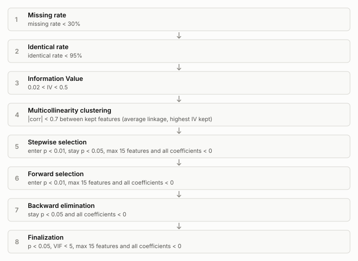
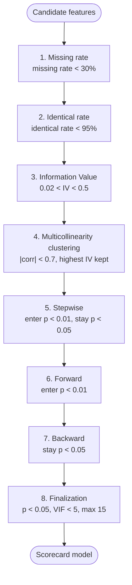
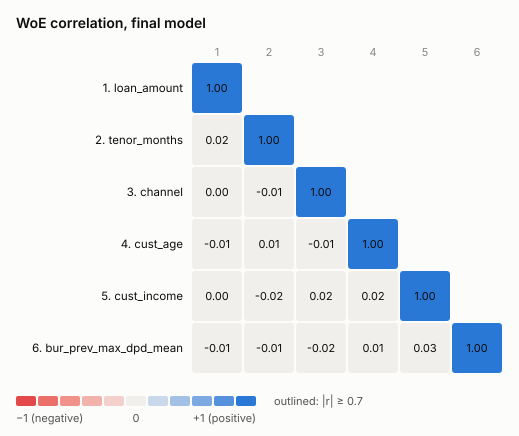
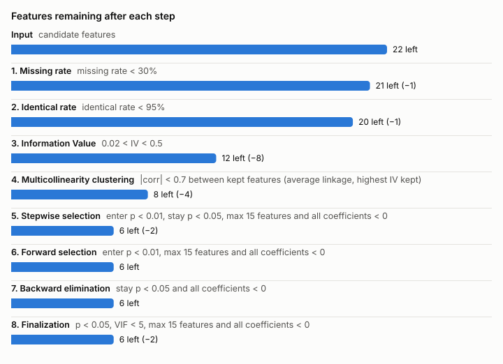

# Modelling waterfall

The modelling waterfall decides **which features go into the scorecard**. It is an
ordered list of steps. Each step receives the features that survived the previous
step, keeps some and drops the rest, and **every drop is recorded with its reason**.

The waterfall is a plan, not code. It can be reordered, re-parameterised or have
steps switched off, and it is **shown to the user and approved before the
Modeller runs it**.

Code: `autoscorecard/engine/waterfall.py` (steps, runner) and
`autoscorecard/engine/waterfall_report.py` (diagrams, report).
Example output from the synthetic demo: [`examples/waterfall_report.md`](examples/waterfall_report.md).



## Default sequence

| # | Step | A feature is kept when | Notes |
|---|---|---|---|
| 1 | Missing rate | missing rate **< 30%** | share of empty values in the training sample |
| 2 | Identical rate | identical rate **< 95%** | share of rows holding the single most frequent value; missing counts as a value (`include_missing: true`) |
| 3 | Information Value | **0.02 < IV < 0.5** | IV of the monotonic WoE binning (see [binning.md](binning.md)). IV ≥ 0.5 is treated as possible leakage |
| 4 | Multicollinearity clustering | **\|corr\| < 0.7** between kept features | hierarchical clustering of the WoE correlation matrix; in each cluster only the highest-IV feature stays |
| 5 | Stepwise selection | enters at LR-test **p < 0.01**, stays at Wald **p < 0.05**, all coefficients < 0 | |
| 6 | Forward selection | enters at **p < 0.01**, all coefficients < 0 | re-run on the stepwise survivors |
| 7 | Backward elimination | stays at **p < 0.05**, all coefficients < 0 | re-run on the forward survivors |
| 8 | Finalization | **p < 0.05, VIF < 5, at most 15 features**, all coefficients < 0 | final model checks |

The boundaries are strict: a feature with exactly 30% missing is dropped, and so
is one with IV exactly 0.02.



## How each step works

All statistics are computed on the **training sample only**. Test and
out-of-time samples are never used to choose features.

**1. Missing rate.** `missing_rate = rows where the value is empty / all rows`.
Dropped when `missing_rate >= max`.

**2. Identical rate.** `identical_rate = rows equal to the most frequent value / all rows`.
With `include_missing: true` (default), "missing" counts as a value, so a column
that is 96% empty also fails here. Dropped when `identical_rate >= max`.

**3. Information Value.** Each feature is binned (monotonic bad rate, see
[binning.md](binning.md)), then
`IV = Σ (dist_good − dist_bad) × ln(dist_good / dist_bad)`.
Dropped when `IV <= min` (no predictive power) or `IV >= max`. Features that
cannot be binned (for example a single distinct value) are also dropped here.
Common reading: < 0.02 useless, 0.02–0.1 weak, 0.1–0.3 medium, 0.3–0.5 strong,
≥ 0.5 suspicious.

**4. Multicollinearity clustering.** On the WoE-transformed features:
1. Compute the correlation matrix and the distance `d = 1 − |corr|`.
2. Agglomerative clustering: start with each feature alone, then repeatedly join
   the two closest clusters. The distance between clusters depends on `linkage`:
   `single` = closest pair, `complete` = farthest pair, `average` = mean of all
   pairs (default).
3. Cut the tree at `d = 1 − threshold`, so features in one cluster are linked
   at `|corr| >= 0.7`.
4. Keep the highest-IV feature from each cluster and drop the rest. The reason
   names the kept feature and the correlation.
5. **Pairwise check.** Average linkage compares cluster averages, so two features
   in different clusters can still have |corr| ≥ 0.7. The limit is enforced
   strictly: going from highest to lowest IV, a kept feature that has
   |corr| ≥ threshold with an already kept one is dropped (reason:
   `pairwise check after clustering`). Every pair of survivors has
   |corr| < threshold. Forced features re-enter later, at finalization, where the
   VIF check applies to them.

The full merge tree is saved in `clusters.json`, so a dendrogram can be drawn.

**5. Stepwise selection.** Start with no features. At each round, try adding each
candidate. Skip any candidate that would make a coefficient positive (see below).
Add the one with the smallest likelihood-ratio p-value
(`LR = 2 × (loglik_new − loglik_old)`, chi-square with 1 df), if it is below
`p_enter`. After each addition, remove any feature whose Wald p-value has risen
above `p_remove`. A removed feature cannot come back, so the process cannot
cycle. Stop when nothing qualifies or `max_features` is reached.

**6. Forward selection.** The same entry rule as stepwise, without removals,
applied to the stepwise survivors. It confirms that each survivor still earns
its place when the features are added in a clean forward order.

**7. Backward elimination.** Start with all survivors. Remove a feature with a
positive coefficient first, otherwise the one with the largest Wald p-value
while that p-value is above `p_remove`.

**8. Finalization.** Fit the model and fix one problem at a time, refitting after
each removal, in this priority:
1. positive coefficient (largest first),
2. p-value ≥ `max_p_value` (largest first),
3. VIF ≥ `max_vif` (largest first), where `VIF_j = 1 / (1 − R²_j)` from
   regressing feature j on the others,
4. more than `max_features` features (smallest |z| first). Forced features do
   not count towards this limit.

Finalization also handles the modeller's own input: **forced features** and
**manual WoE edits**, described in [Finalization: edits, forced features and
confirmation](#finalization-edits-forced-features-and-confirmation).

**Why coefficients must be negative.** With WoE = ln(%good / %bad) and y = 1 for
bad, a higher WoE means a safer customer. So every coefficient of a sensible
model is negative. A positive coefficient usually means the feature is offsetting
a correlated one, which would give points in the wrong direction.

## Changing the plan

The default lives in `config/config.yaml` under `modelling.waterfall`:

```yaml
modelling:
  waterfall:
    - {type: missing_rate,        params: {max: 0.30}}
    - {type: identical_rate,      params: {max: 0.95}}
    - {type: iv,                  params: {min: 0.02, max: 0.5}}
    - {type: correlation_cluster, params: {threshold: 0.7, linkage: average}}
    - {type: stepwise,            params: {p_enter: 0.01, p_remove: 0.05}}
    - {type: forward,             params: {p_enter: 0.01}}
    - {type: backward,            params: {p_remove: 0.05}}
    - {type: finalization,        params: {max_p_value: 0.05, max_vif: 5.0, max_features: 15}}
```

- **Reorder** the list to change the sequence.
- **Skip** a step with `enabled: false`; it stays in the plan, marked as skipped.
- **Unspecified parameters** take their defaults. All parameters are listed below.

| type | parameters (default) |
|---|---|
| `missing_rate` | `max` (0.30) |
| `identical_rate` | `max` (0.95), `include_missing` (true) |
| `iv` | `min` (0.02), `max` (0.5) |
| `correlation_cluster` | `threshold` (0.7), `linkage` (average \| single \| complete) |
| `stepwise` | `p_enter` (0.01), `p_remove` (0.05), `max_features` (15), `require_negative` (true) |
| `forward` | `p_enter` (0.01), `max_features` (15), `require_negative` (true) |
| `backward` | `p_remove` (0.05), `require_negative` (true) |
| `finalization` | `max_p_value` (0.05), `max_vif` (5.0), `max_features` (15), `require_negative` (true) |

Custom steps (for example `exclude_by_policy` in `plugins/steps/`) are used the same way; see [extending.md](extending.md) to write your own.

Validation rejects a plan with an unknown step or parameter, a step used twice,
a rate or p-value outside 0–1, `iv.min >= iv.max`, or `finalization` anywhere but
last. Plans that are legal but unusual produce warnings shown next to the plan:
a filter placed after model selection, or no IV, clustering or model step.

## Approval flow

1. A project starts from the config plan. The user (through the Partner agent,
   and later the plan editor in the game UI) can edit it per project. It is
   saved to `projects/<id>/work/waterfall.json`.
2. The plan is presented as a diagram (`waterfall_plan.svg` / Mermaid) plus a
   table of criteria and warnings (`waterfall_plan.md`).
3. The user approves it. **Any later edit clears the approval.**
4. The Modeller runs `build_scorecard(..., require_approved=True)`, which refuses
   to run an unapproved plan.

Saving, approving and every drop are written to the project's `audit.jsonl`.

| API | Purpose |
|---|---|
| `GET /api/waterfall/step-types` | building blocks for the editor: types, defaults, help text |
| `GET /api/projects/{id}/waterfall` | current plan, criteria, warnings, Mermaid, Markdown, approval status |
| `PUT /api/projects/{id}/waterfall` | replace the plan (`{"steps": [...]}`); clears approval |
| `POST /api/projects/{id}/waterfall/approve` | approve the current plan |
| `GET /api/projects/{id}/waterfall/plan.svg` | the plan diagram |

## Finalization: edits, forced features and confirmation

The waterfall is automatic up to finalization. Finalization is where the modeller
can step in, and **the result must be confirmed before the scorecard is final**.

### Forced features: tried, then kept or discarded

`forced_features` lists features that **must be tried**, even if the waterfall
dropped them (missing rate, IV, clustering, stepwise…) or they were never
selected.

1. Finalization runs on the waterfall's survivors as usual (forced survivors are
   protected from the feature limit).
2. Every forced feature that is not in the model is added back, binned with the
   same monotonic rules.
3. The finalization checks run again on the combined model. A forced feature is
   **discarded only if it still fails a check inside the model**: positive
   coefficient, p-value ≥ `max_p_value`, or VIF ≥ `max_vif`. The reason reads
   `forced into the model but still fails: …`.
4. Forced features never count towards `max_features`, so they never push out a
   feature the waterfall chose.

Each forced feature is reported with the step that originally dropped it, why,
and the final result (`kept` / `discarded`). In `waterfall_features.csv` its
status is `forced → selected` or `forced → discarded`. Finalization requires an
enabled `finalization` step.

### Manual WoE edits

Two kinds, both shown before/after in the review:

| edit | input | effect |
|---|---|---|
| **Bins** (preferred) | `manual_bins: {"cust_age": {"edges": [25, 35, 45, 55]}}` or `{"groups": [[...], ...]}` | cut points / category groups set by hand. WoE and IV are **recalculated from the data**; bins are never merged. Flagged if not monotonic |
| **WoE override** | `woe_overrides: {"cust_age": {"(-inf, 25]": -0.40}}` plus a **required reason** | the WoE of a bin is set by hand. The calculated value stays visible (`woe_calc`), the bin is marked `woe_edited`. IV stays data-based; points use the edited WoE. Flagged if WoE is no longer monotonic |

Bin labels for overrides are exactly those in the bin table (e.g. `(25, 35]`,
`__MISSING__`). An unknown label is rejected. Edits apply from the start of the
waterfall, so the IV filter, clustering and selection all see the edited WoE.

### Confirmation

Every build is a **draft** with its own `build_id`:

1. Inputs are saved to `projects/<id>/work/finalization.json`
   (`PUT /api/projects/{id}/finalization`, or the Partner agent).
2. The build writes `finalization_review.md` (forced features and results, every
   edit before/after with its reason) and `finalization_status.json`
   (`pending_confirmation`). `scorecard.json` carries
   `meta.status = "pending_confirmation"`.
3. The user reviews it and confirms that build:
   `POST /api/projects/{id}/finalization/confirm {"build_id": "...", "note": "..."}`.
   `scorecard.json` becomes `meta.status = "confirmed"`.
4. A confirmation is refused if the build is not the latest one, or if the inputs
   changed after the build ran. **Edit → rebuild → review → confirm.**

Saving inputs, each forced-feature outcome, each edit, the pending build and the
confirmation are all in `audit.jsonl`.

| API | Purpose |
|---|---|
| `GET /api/projects/{id}/finalization` | inputs, latest build status, review Markdown, whether inputs changed since the build |
| `PUT /api/projects/{id}/finalization` | save `forced_features`, `manual_bins`, `woe_overrides`, `reasons` |
| `POST /api/projects/{id}/finalization/confirm` | confirm a build (409 if stale or not the latest) |

Example: [`examples/finalization_review.md`](examples/finalization_review.md).

## WoE correlation heatmap

The report shows the correlation of the WoE values of the **final model's**
features on the training sample. It is a lower triangle with the value in every
cell, rows numbered and named, columns numbered. Blue is positive, red is
negative and gray is near zero (11 steps from −1 to +1). Cells at or above the
clustering threshold (`|r| ≥ 0.7`) are outlined. Hovering a cell names the pair.
The same matrix is in the report as a table and in `woe_correlation.csv`.



## The waterfall report

Each build writes these files to `projects/<id>/artifacts/`:

| file | content |
|---|---|
| `waterfall_report.md` | the full report: summary, chart, flow with counts, per-step details (clusters, selection traces, every drop with its reason), **raw data (data dictionary)**, final model, **WoE correlation heatmap** (+ raw-value heatmap for reference), **finalization review**, performance, binning check, every feature |
| `woe_correlation.svg`, `woe_correlation.csv` | WoE correlation of the final model's features |
| `raw_correlation.svg`, `raw_correlation.csv` | raw-value (Spearman) correlation, reference only |
| `data_dictionary.md`, `data_dictionary.csv` | the raw-data documentation, see [data_dictionary.md](data_dictionary.md) |
| `finalization_review.md`, `finalization_status.json` | what needs confirming, and whether it is confirmed |
| `waterfall.svg` | features remaining after each step |
| `waterfall_summary.csv` | one row per step: criterion, in, dropped, out |
| `waterfall_features.csv` | one row per candidate feature: missing rate, identical rate, status, step where it was dropped, reason |
| `waterfall_plan.md`, `waterfall_plan.svg` | the plan that was run |
| `selection_steps.csv`, `clusters.json` | stepwise/forward/backward traces and the cluster tree |

The report is part of the model documentation and feeds the deck (Phase 3).

Example from the synthetic demo (`scripts/demo_scorecard.py --docs`):


